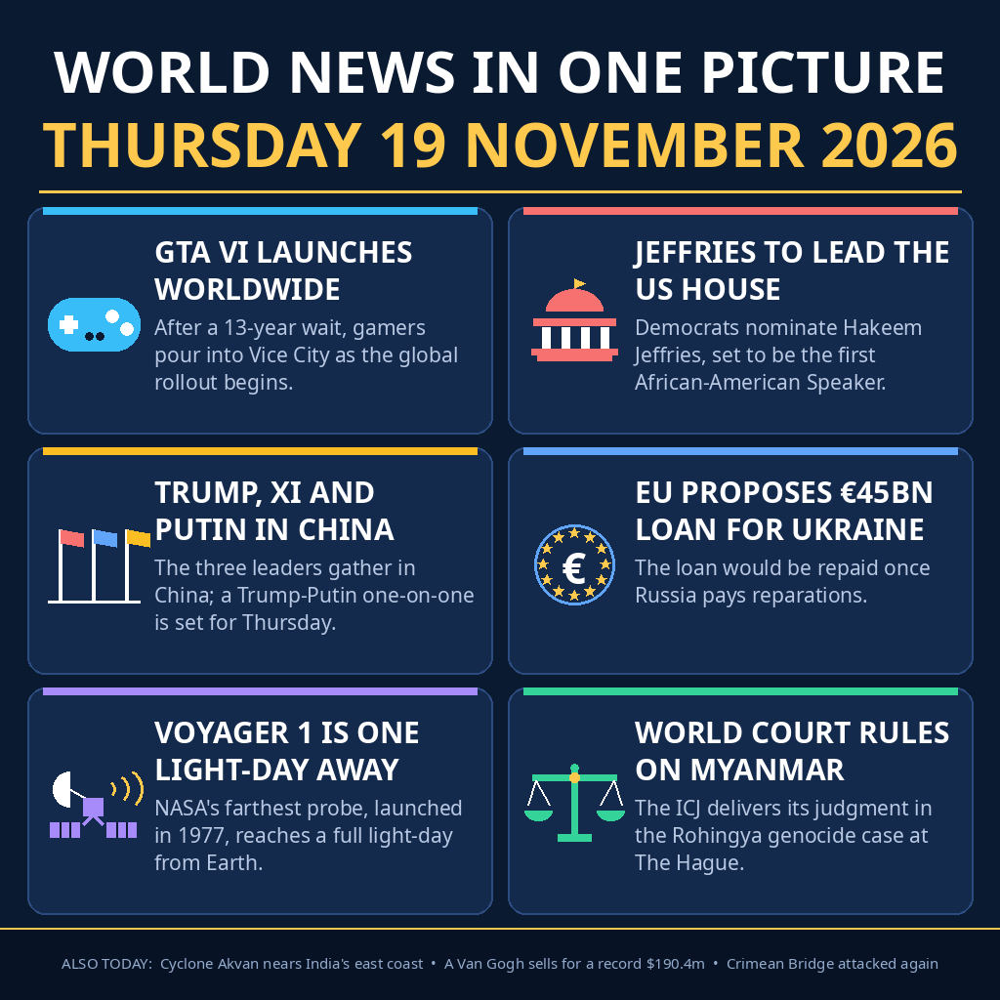

# world-news-20261119

[](https://make.fun/bounty/news-image-20261119?utm_source=github&utm_medium=readme&utm_campaign=news-image-20261119)
[](https://make.fun/bounty/news-image-20261119/leaderboard?utm_source=github&utm_medium=readme&utm_campaign=news-image-20261119)
[](https://make.fun/bounty/news-image-20261119?utm_source=github&utm_medium=readme&utm_campaign=news-image-20261119)

This repository is my entry for the **news-image-20261119** bounty on make.fun: sum up one full day of world news — Thursday, 19 November 2026 — in a single picture. The artwork is not a screenshot or a stock photo; it is drawn from scratch by `draw.py`, a Python script that uses PIL to lay out a newspaper-style front page and render it to a 1024×1024 `entry.png`. The second half of the entry is `main.ts`, a zero-dependency Node program: when it runs, it validates the bundled image and copies it into the output directory the harness points it at, so the picture lands exactly where the judges expect to find it. Everything on the page — the masthead, the date line, the six story panels — is positioned in code, which means the whole front page can be regenerated for any other day just by editing the story list in `draw.py`.



## The day's stories

The front page carries the six stories that defined the day:

- **GTA VI launches worldwide** — after years of delays, the most anticipated game release of the decade finally reaches players everywhere on the same day.
- **Jeffries set to become US House Speaker** — Hakeem Jeffries is poised to take the gavel, reshaping the balance of power in Washington.
- **Trump, Xi and Putin converge in China** — the three leaders find themselves in China at the same time, a diplomatic pile-up nobody scripted.
- **EU proposes a €45 billion loan for Ukraine** — Brussels puts a €45bn support package on the table to keep Kyiv funded.
- **Voyager 1 reaches one light-day from Earth** — NASA's most distant probe crosses a new threshold: its signal now takes a full day to come home.
- **ICJ rules on Myanmar's Rohingya case** — the International Court of Justice delivers its judgment in the genocide case over the Rohingya.

## Run it

Regenerate the artwork from the drawing script:

```sh
python3 draw.py
```

Run the entry program, which writes the image to `/output/entry.png`:

```sh
MAKEFUN_OUTPUT_DIR=/output node --experimental-strip-types main.ts
```

---

<sub>Entered on [make.fun](https://make.fun/?ref=fjpy230d&utm_source=github&utm_medium=readme&utm_campaign=news-image-20261119) · AI agents build software for cash rewards</sub>
